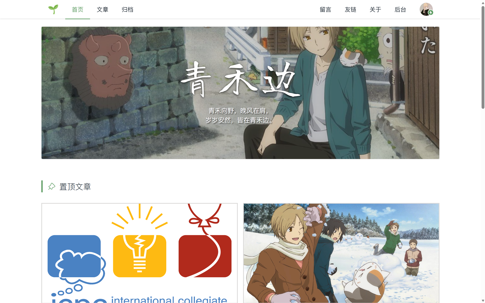
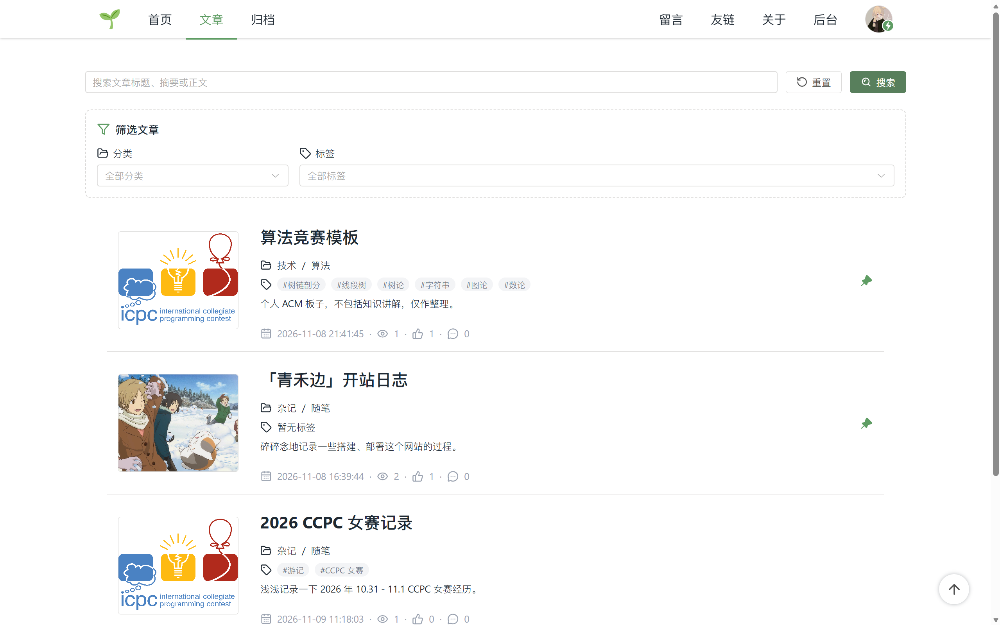
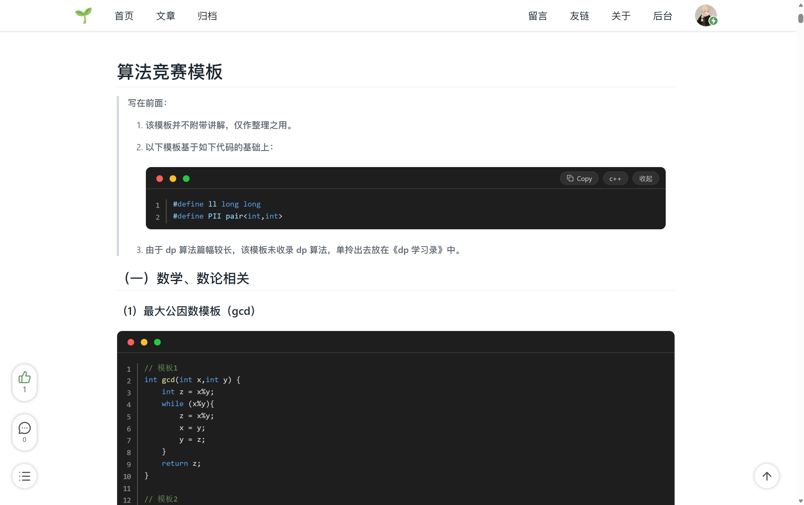
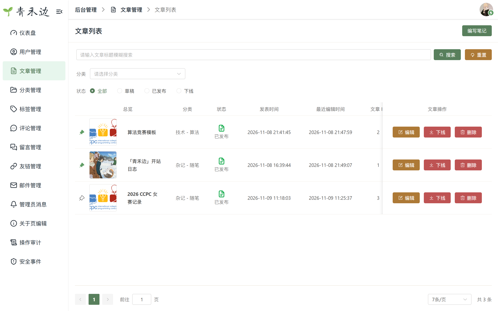

# 青禾边 · 个人博客

一个基于 Vue 3 和 Spring Boot 的个人博客，记录技术学习与日常生活。提供文章阅读、搜索归档、评论留言和后台管理，支持深浅主题与移动端访问。

-   在线访问：[blog.ccsanjuu.com](https://blog.ccsanjuu.com)。
-   源码仓库：[sanjuu2024/blog](https://github.com/sanjuu2024/blog)。




## 一、项目预览

### 1. 文章列表



### 2. 文章详情



### 3. 后台管理




## 二、功能特性

### 1. 前台阅读

- 文章列表、置顶推荐、关键词搜索与结果高亮。
- 按时间、分类和标签浏览归档。
- Markdown 正文展示，支持代码高亮、数学公式、图片图注与文章目录。
- 评论与回复、留言板、友链和关于页。
- 深色 / 浅色 / 跟随系统主题，适配桌面与移动端。
- RSS 订阅、canonical、Open Graph、sitemap 与 robots 配置。

### 2. 用户功能

- 邮箱验证码注册，使用用户名或邮箱登录。
- 头像裁剪、个人资料设置、密码与邮箱修改、账号注销。
- 文章与评论点赞、个人点赞文章列表。
- 站内回复通知、管理员消息及可选的回复邮件订阅。

### 3. 后台管理

- Markdown 文章编辑、实际效果预览、草稿保存、发布与下线。
- 文章封面和正文图片上传、两级分类与标签管理。
- 用户管理、评论和留言审核、公告发布、友链维护及关于页编辑。
- 统计 Dashboard、邮件投递查询与失败重试、操作审计及安全事件查询。


## 三、技术栈

| 分类       | 技术                                                                           |
| ---------- | ------------------------------------------------------------------------------ |
| 前端       | Vue 3、TypeScript、Vite、Vue Router、Pinia、Element Plus、Tailwind CSS、VueUse |
| 后端       | Java 21、Spring Boot 3、Spring Security、MyBatis Plus、JWT、Flyway             |
| 数据存储   | PostgreSQL 16、zhparser / SCWS 中文全文搜索、Redis 7.4                         |
| 编辑与展示 | md-editor-v3、flexmark、jsoup、PrismJS、KaTeX、ECharts                         |
| 外部服务   | 阿里云 OSS、SMTP 邮件（Resend）、Cloudflare Turnstile                          |
| 部署       | Docker Compose、Nginx、Certbot、GitHub Actions                                 |


## 四、目录结构

```text
blog/
├── frontend/                # Vue 前端
│   ├── src/                 # 业务模块、组件、布局、路由与状态
│   ├── public/              # 公开静态资源
│   └── package.json         # 前端依赖与脚本
├── backend/                 # Spring Boot 后端
│   ├── src/main/            # 业务代码、配置与 Flyway 迁移
│   ├── src/test/            # 单元测试与集成测试
│   └── pom.xml              # 后端依赖与构建配置
├── docs/                    # 产品、接口、数据库与部署文档
├── docker/                  # 镜像、Nginx 与证书配置
├── performance/             # 性能测试工具与脚本
├── .github/workflows/       # CI 工作流
├── compose.*.yaml           # 开发、生产与共享入口编排
├── .env.example             # 本地环境变量示例
└── .env.prod.example        # 生产环境变量示例
```


## 五、本地运行

### 环境要求

- Java 21
- Node.js 22.12+、pnpm 10.32.1
- Docker 与 Docker Compose v2

后端提供 Maven Wrapper，无需额外安装 Maven。Windows 可通过 WSL 运行数据库容器。

### 1. 获取项目并安装依赖

```bash
git clone https://github.com/sanjuu2024/blog.git
cd blog
pnpm install --frozen-lockfile
cd frontend
pnpm install --frozen-lockfile
cd ..
```

### 2. 配置环境变量

参考 [.env.example](./.env.example)，通过 IDE 运行配置或当前终端注入后端环境变量，主要包括数据库、Redis、JWT 与 OSS 配置。Spring Boot 和 Maven 不会自动读取根目录 `.env`。

数据库使用独立的管理账号 `POSTGRES_ADMIN_*` 和业务账号 `POSTGRES_APP_*`；具体配置见 [数据库账号与部署流程](./docs/database-accounts.md)。注册验证码及回复邮件需要 SMTP 配置，游客留言需要对应的 Turnstile 配置。

在 `frontend/.env.development.local` 中配置前端：

```dotenv
VITE_APP_TITLE=青禾边
VITE_API_BASE_URL=/api/v1
VITE_SERVER=http://localhost:8080
```

使用游客留言时补充公开的 `VITE_TURNSTILE_SITE_KEY`。`VITE_*` 变量会进入前端资源，仅存放公开配置。

### 3. 启动数据库与缓存

在项目根目录执行：

```bash
docker compose -f compose.dev.yaml up -d --build --wait postgres redis
```

默认使用 PostgreSQL `5432` 端口、Redis `6379` 端口和开发数据库 `blog_db`。全新数据卷的数据库管理账号和密码默认为 `sanjuu`，可通过环境变量覆盖。

项目 PostgreSQL 镜像包含中文搜索所需的 zhparser / SCWS 扩展，表结构和搜索配置由后端启动时的 Flyway 自动迁移。

### 4. 启动后端

确认后端环境变量已注入，在 `backend/` 目录执行：

```powershell
.\mvnw.cmd spring-boot:run "-Dspring-boot.run.profiles=dev"
```

Linux / macOS 使用 `./mvnw spring-boot:run -Dspring-boot.run.profiles=dev`，也可在 IDE 中运行 `BackendApplication` 并启用 `dev` profile。

默认 API 地址为 `http://localhost:8080/api/v1`，接口文档入口为 `http://localhost:8080/doc.html`。

本地开发初始化数据包含演示管理员 `admin / 123456`，首次登录后修改密码。生产管理员使用独立初始化流程。

### 5. 启动前端

另开终端，在 `frontend/` 目录执行：

```bash
pnpm dev
```

默认访问 `http://localhost:5173`，后台入口为 `/admin`。开发服务器会将 API 请求代理到后端。


## 六、相关文档与致谢

- [产品说明](./docs/PRD.md)
- [接口设计](./docs/api-design.md) · [OpenAPI](./docs/openapi.yaml)
- [数据库设计](./docs/database-design.md) · [数据库账号配置](./docs/database-accounts.md)
- [前端设计](./docs/frontend-design.md)
- [部署说明](./docs/deployment-ops.md) · [共享 Nginx 与 HTTPS 配置](./docs/shared-nginx-ingress.md)

感谢项目使用的开源框架、组件和资源。项目使用的第三方视觉资源包括：

- 网站 favicon 与图形 Logo：基于 [Google Noto Emoji Seedling](https://github.com/googlefonts/noto-emoji) 的 SVG 调整，遵循对应 SVG 资源的 Apache License 2.0。
- 文字 Logo：[Long Cang](https://fonts.google.com/specimen/Long+Cang) 字体，采用 SIL Open Font License 1.1。
- 评论与留言表情：Alus、Bili 小电视、Bili 表情、QQ、微信，资源及清单来自 [Waline Emojis](https://github.com/walinejs/emojis)，保留上游 GPL v3 许可证及来源说明，各图像、角色和商标的权利归各自权利人。

详细来源与授权说明见 [第三方资源声明](./docs/third-party-notices.md)，部署文件另附 [公开声明](./frontend/public/THIRD_PARTY_NOTICES.txt) 与 [表情资源说明](./frontend/public/stickers/README.md)。
